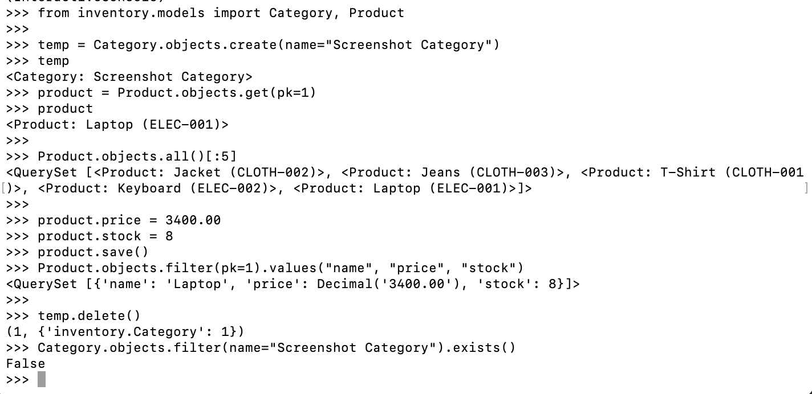
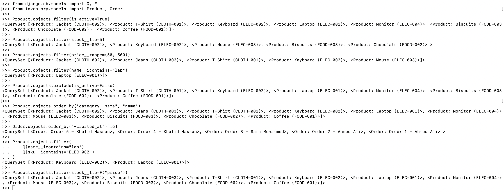
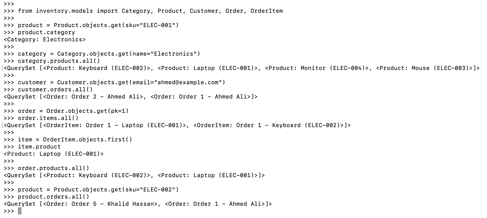
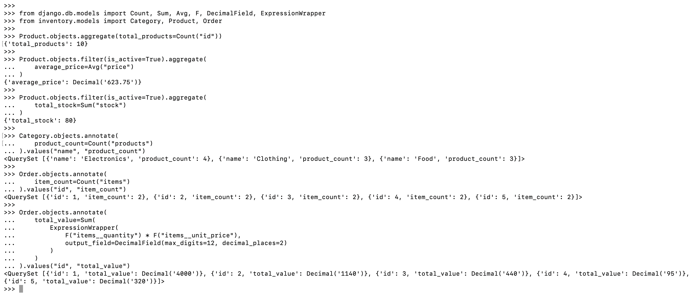
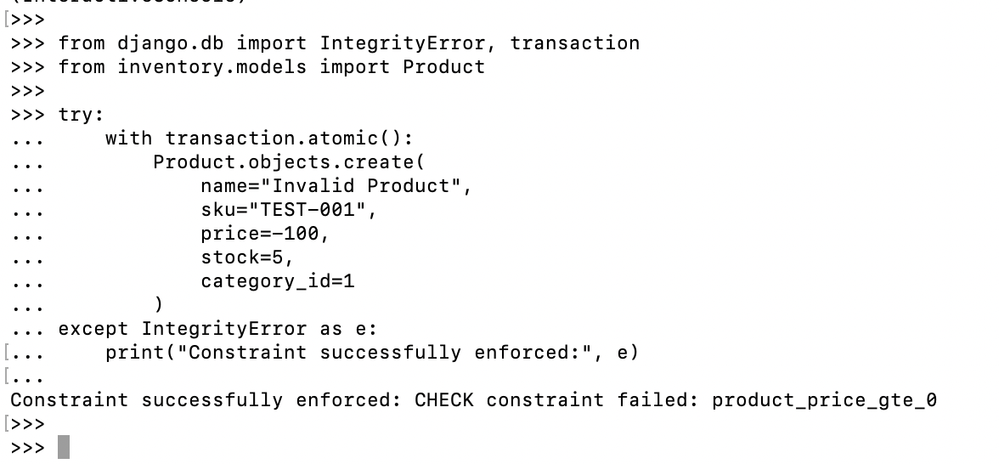
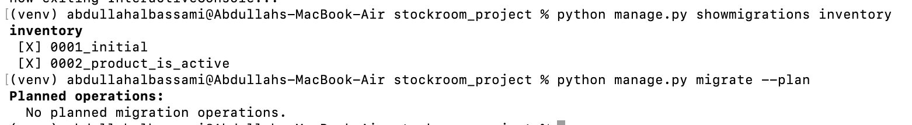
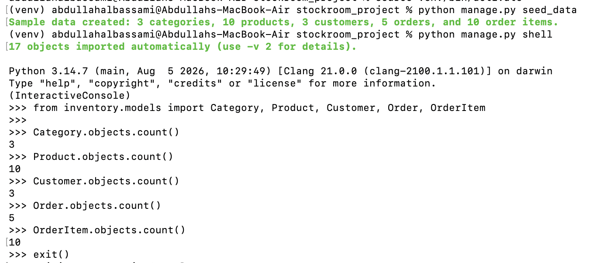
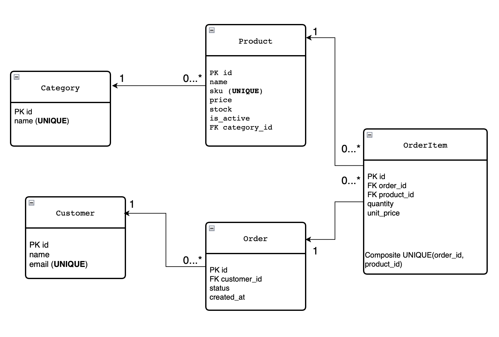

# StockRoom

StockRoom is a Django catalogue and order data system focused on relational database design and correct use of the Django ORM.

The project demonstrates the complete data flow from relational modelling to Django models, migrations, CRUD operations, QuerySets, relationship traversal, annotation, and aggregation.

## Project Structure

```text
AbdullahAlbassami-Unit5/
├── ERD/
│   └── stockroom_erd.png
├── screenshots/
│   ├── CRUD.png
│   ├── QuerySets.png
│   ├── Relationships.png
│   ├── Aggregation_Annotation.png
│   ├── Constraints.png
│   ├── Migrations.png
│   └── Seed_Data.png
├── README.md
├── requirements.txt
└── stockroom_project/
    ├── manage.py
    ├── inventory/
    │   ├── admin.py
    │   ├── models.py
    │   ├── queries.py
    │   ├── migrations/
    │   │   ├── 0001_initial.py
    │   │   └── 0002_product_is_active.py
    │   └── management/
    │       └── commands/
    │           └── seed_data.py
    └── stockroom_project/
        ├── settings.py
        ├── urls.py
        ├── asgi.py
        └── wsgi.py
```

## Data Model

The project contains five main models:

| Model | Main Data |
|---|---|
| Category | name |
| Product | name, sku, price, stock, is_active, category |
| Customer | name, email |
| Order | customer, status, created_at |
| OrderItem | order, product, quantity, unit_price |

Each model includes a meaningful `__str__()` representation.

## Relationships

The database relationships are:

- Category → Product: one-to-many
- Customer → Order: one-to-many
- Order → OrderItem: one-to-many
- Product → OrderItem: one-to-many
- Order ↔ Product: many-to-many through `OrderItem`

`OrderItem` is used as a through model because the relationship between an order and a product also stores:

- `quantity`
- `unit_price`

A normal automatic many-to-many table would not be sufficient because these values belong to the relationship itself.

## Foreign Key Deletion Behavior

### Category → Product

```python
on_delete=models.PROTECT
```

A category cannot be deleted while products still reference it.

### Customer → Order

```python
on_delete=models.PROTECT
```

A customer cannot be deleted while existing orders reference that customer.

### Order → OrderItem

```python
on_delete=models.CASCADE
```

Deleting an order also deletes its related order items because those items belong specifically to that order.

### Product → OrderItem

```python
on_delete=models.PROTECT
```

A product referenced by an existing order item cannot be deleted, preserving historical order data.

## Data Integrity

Database constraints ensure that:

- `Product.sku` is unique.
- `Customer.email` is unique.
- Product price cannot be negative.
- Product stock cannot be negative.
- OrderItem quantity must be at least 1.
- OrderItem unit price cannot be negative.
- The same product cannot appear twice in the same order.

The final rule is implemented using a unique constraint on:

```text
(order, product)
```

## Meta Options

Useful default ordering is defined with `class Meta`.

- Categories are ordered by name.
- Products are ordered by category name and then product name.
- Orders are ordered by newest creation time first.

## Migrations

The project contains two inventory migrations.

### Initial Migration

```text
0001_initial.py
```

Creates the initial models, relationships, and database constraints.

### Deliberate Schema Change

```text
0002_product_is_active.py
```

Adds the `Product.is_active` field after the initial migration.

Both migrations have been successfully applied.

The model definitions are also synchronized with the migration history:

```bash
python manage.py makemigrations --check --dry-run
```

Result:

```text
No changes detected
```

## Sample Data

The project uses the following sample dataset:

- 3 categories
- 10 products
- 3 customers
- 5 orders
- 10 order items

The product data includes:

- Active products
- Inactive products
- Low-stock products
- A zero-stock product
- Different price ranges

This provides meaningful data for all required queries.

### Sample Data Management Command

The complete sample dataset can be generated with:

```bash
python manage.py seed_data
```

The command is implemented in:

```text
inventory/management/commands/seed_data.py
```

It recreates the inventory sample data and produces:

```text
3 categories
10 products
3 customers
5 orders
10 order items
```

This makes the required sample data reproducible without manually entering every record through the Django shell.

## CRUD Operations

The project demonstrates all four CRUD operations:

- Create
- Retrieve
- Update
- Delete

The evidence demonstrates:

- Creating a record
- Retrieving a record by primary key
- Listing several records
- Updating a product's price and stock
- Deleting an unreferenced record
- Confirming that the deleted record no longer exists

Reusable CRUD operations are also organized in:

```text
inventory/queries.py
```

## QuerySet Operations

The required QuerySet operations are implemented in `inventory/queries.py`.

| Business Question | ORM Statement / Feature |
|---|---|
| Which products are active? | `Product.objects.filter(is_active=True)` |
| Which products have stock less than or equal to 5? | `Product.objects.filter(stock__lte=5)` |
| Which products fall within a selected price range? | `Product.objects.filter(price__range=(50, 500))` |
| Which product names contain a value regardless of case? | `Product.objects.filter(name__icontains="lap")` |
| Which products remain after excluding inactive products? | `Product.objects.exclude(is_active=False)` |
| How can products be ordered by category and then product name? | `Product.objects.order_by("category__name", "name")` |
| What are the five most recently created orders? | `Order.objects.order_by("-created_at")[:5]` |
| Which products match a name OR SKU search? | `Q` object with OR |
| How can database fields be compared directly? | `F` expression |

The executed ORM statements and returned results are shown in the QuerySet evidence screenshot.

## Relationship Traversal

The project demonstrates all required relationship queries:

| Requirement | Example |
|---|---|
| Product → Category | `product.category` |
| Category → Products | `category.products.all()` |
| Customer → Orders | `customer.orders.all()` |
| Order → OrderItems | `order.items.all()` |
| OrderItem → Product | `item.product` |
| Order → Products | `order.products.all()` |
| Product → Orders | `product.orders.all()` |

### Forward Relationship Traversal

Forward traversal starts from the model containing the `ForeignKey` and accesses the referenced object.

Example:

```python
product.category
```

`Product` contains the foreign key to `Category`.

### Reverse Relationship Traversal

Reverse traversal starts from the referenced model and accesses the objects pointing to it.

Example:

```python
category.products.all()
```

This works because the relationship defines:

```python
related_name="products"
```

## Why OrderItem Is a Separate Model

`OrderItem` is required because the many-to-many relationship between `Order` and `Product` contains additional data:

```text
quantity
unit_price
```

These values describe each particular product within an order, so `OrderItem` acts as an explicit through model.

## get() vs filter()

`get()` is used when exactly one matching object is expected.

Example:

```python
Product.objects.get(pk=1)
```

It returns one object and raises an exception if no object matches or if multiple objects match.

`filter()` returns a QuerySet:

```python
Product.objects.filter(is_active=True)
```

A filtered QuerySet may contain zero, one, or many objects.

## Lazy QuerySets

Django QuerySets are lazy because creating a QuerySet normally does not immediately execute its database query.

For example:

```python
products = Product.objects.filter(is_active=True)
```

The query is normally evaluated when its results are actually needed, such as during iteration, conversion to a list, or displaying the results.

## Annotation and Aggregation

All required calculations are performed in the database through the Django ORM rather than ordinary Python loops.

| Business Question | ORM Approach |
|---|---|
| How many products are stored? | `aggregate()` with `Count` |
| What is the average price of active products? | `filter()` then `aggregate()` with `Avg` |
| What is the total stock of active products? | `filter()` then `aggregate()` with `Sum` |
| How many products belong to each category? | `annotate()` with `Count` |
| How many order items belong to each order? | `annotate()` with `Count` |
| What is the total value of each order? | `F` expressions, multiplication, and `Sum` |

### aggregate()

`aggregate()` calculates a summary across the entire QuerySet and returns one dictionary.

Example:

```python
Product.objects.aggregate(
    total_products=Count("id")
)
```

### annotate()

`annotate()` adds a calculated value to each returned object or group.

Example:

```python
Category.objects.annotate(
    product_count=Count("products")
)
```

For the category calculation, each `Category` defines a group.

For the order calculations, each `Order` defines a group.

### Verified Aggregation Results

The ORM calculations match the submitted sample data.

```text
Total products: 10
Average active product price: 623.75
Total active stock: 80
```

Products per category:

```text
Electronics: 4
Clothing: 3
Food: 3
```

Order items per order:

```text
2 items per order
```

Order totals:

```text
Order 1: 4000
Order 2: 1140
Order 3: 440
Order 4: 95
Order 5: 320
```

The executed calculations and returned results are also shown in the annotation and aggregation evidence screenshot.

## Evidence Screenshots

The following screenshots provide evidence of the executed operations and their returned results.

### CRUD Operations



### QuerySet Operations



### Relationship Traversal



### Annotation and Aggregation



### Database Constraints



The constraint evidence demonstrates that the database rejects an invalid product with a negative price:

```text
CHECK constraint failed: product_price_gte_0
```

This confirms that the integrity rule is enforced at the database level.

### Migrations



The migration evidence confirms:

```text
[X] 0001_initial
[X] 0002_product_is_active
```

It also shows that there are no pending migration operations.

### Sample Data



The sample-data evidence demonstrates that the management command successfully recreates and verifies:

```text
3 categories
10 products
3 customers
5 orders
10 order items
```

## ERD

The project ERD is stored at:

```text
ERD/stockroom_erd.png
```



The ERD shows:

- Primary keys
- Foreign keys
- Cardinality
- Optionality
- One-to-many relationships
- The many-to-many relationship between Order and Product through OrderItem
- The unique `(order_id, product_id)` constraint

## Django Admin

All five project models are registered with Django Admin so stored records can be inspected through the admin interface.

Registered models:

- Category
- Product
- Customer
- Order
- OrderItem

## Setup

### 1. Clone the repository

```bash
git clone <repository-url>
cd AbdullahAlbassami-Unit5
```

### 2. Create and activate a virtual environment

```bash
python3 -m venv venv
source venv/bin/activate
```

### 3. Install dependencies

```bash
pip install -r requirements.txt
```

### 4. Move into the Django project

```bash
cd stockroom_project
```

### 5. Apply migrations

```bash
python manage.py migrate
```

### 6. Generate the sample data

```bash
python manage.py seed_data
```

### 7. Check the project

```bash
python manage.py check
```

Expected result:

```text
System check identified no issues (0 silenced).
```

### 8. Run the development server

```bash
python manage.py runserver
```

## Known Limitations

- The project intentionally focuses on the database and Django ORM layer.
- No advanced frontend interface was implemented.
- The sample-data command is intended for development and demonstration and recreates the inventory dataset when executed.

## Future Improvements

Possible improvements include:

- Add automated model and QuerySet tests.
- Add automated constraint tests.
- Add catalogue and order management pages.
- Add forms for creating and updating records.
- Add user authentication and authorization.
- Add search and filtering pages.
- Add reporting dashboards.